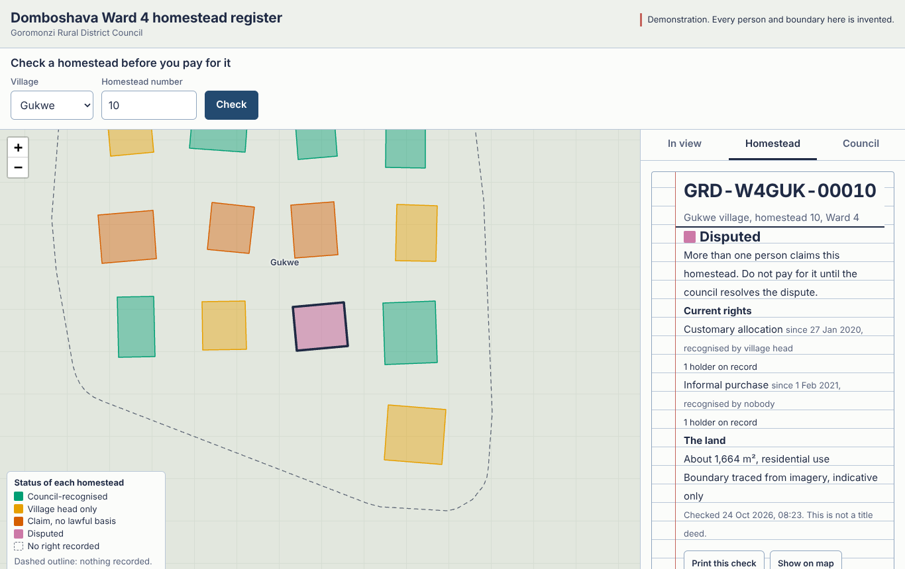
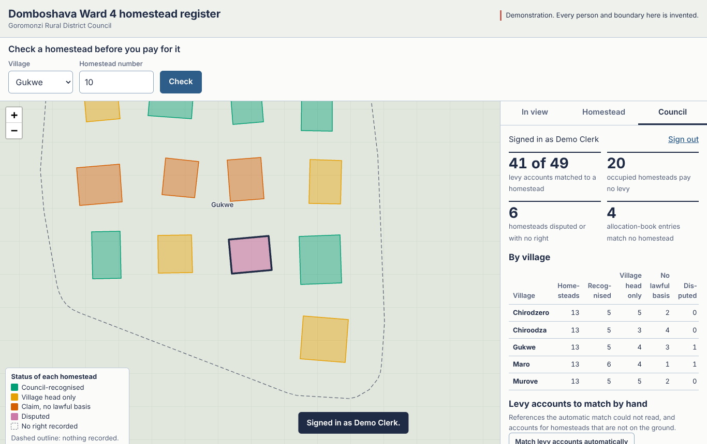

# Domboshava Ward 4 Homestead Register

HSVG437 Cadastres and Land Information Systems — capstone project, Midlands State University.
Group 01: Deans M Chiphumo (R226540E), Zvikomborero Gora (R233060Y), Nokutenda Chigariso (R234667C).

Goromonzi Rural District Council cannot say which occupied homesteads in Domboshava Ward 4 hold a recognised allocation, or whether a homestead is already taken before it is allocated or sold again. The village heads' allocation books and the council's levy register share no identifier and no map. This system links them, reports the gaps, and gives anyone a stand check that answers in seconds.

**Synthetic demonstration data.** Every person, boundary, levy account and book entry in `db/03_seed.sql` is invented. The village names are the five sampled villages (Gukwe, Murove, Chiroodza, Chirodzero, Maro), but their positions and shapes are illustrative. Do not load real personal data except under the proposal's data protection plan.



## What is in the box

```
db/
  01_schema.sql              LADM-shaped schema, Lo 31 CRS, constraints, views
  02_audit_and_security.sql  append-only audit log, lis_api and lis_public roles
  03_seed.sql                65 synthetic homesteads with deliberate defects
  04_queries.sql             the council's questions in SQL (lab-style)
  setup.sh                   builds a database from the three scripts
backend/server/              Express 5 API (OGC API - Features layout)
  src/                       app, routes, auth, error handling
  scripts/create-user.js     creates a clerk account (prints SQL)
  test/api.test.js           20 tests, including the three Lab 4 asks
Frontend/client/             Leaflet map client, no build step
docs/screenshots/
```

## Requirements

- PostgreSQL 14 or later with **PostGIS 3** (Windows: install PostGIS from Stack Builder)
- **Node.js 20** or later
- A browser. The client loads Leaflet from unpkg and tiles from OpenStreetMap, so it needs internet access.

## Set up (about 10 minutes)

### 0. Get the code

```
git clone https://github.com/r233060y/domboshava-lis.git
cd domboshava-lis
```

Or use *Code → Download ZIP* on the GitHub page and unzip it.

### 1. Build the database

Linux or macOS:

```bash
./db/setup.sh                      # creates domboshava_lis
```

Windows with **pgAdmin**:

1. Create the database (right-click *Databases* → *Create* → *Database…*). Any name works; the examples here use `domboshava_lis`.
2. Select the new database, then open *Tools* → *Query Tool*.
3. Open `db/01_schema.sql` (folder icon), press **F5**, and wait for *Query returned successfully*.
4. Do the same for `02_audit_and_security.sql`, then `03_seed.sql`, in that order.

Each file is one transaction. If one fails, nothing from it is kept: fix the cause and run it again. If a file says *already exists*, it has already run, so move on to the next.

Windows with **psql** (PowerShell; add `C:\Program Files\PostgreSQL\18\bin` to your PATH first):

```powershell
psql -U postgres -c "CREATE DATABASE domboshava_lis"
psql -U postgres -d domboshava_lis -v ON_ERROR_STOP=1 -f db/01_schema.sql
psql -U postgres -d domboshava_lis -v ON_ERROR_STOP=1 -f db/02_audit_and_security.sql
psql -U postgres -d domboshava_lis -v ON_ERROR_STOP=1 -f db/03_seed.sql
```

The seed ends by showing 5 villages and 65 homesteads (in pgAdmin, under *Data Output*).

### 2. Give the two database roles passwords

There are deliberately no default passwords. Run these in the Query Tool or psql.

Roles belong to the whole PostgreSQL server, not to one database. If you did Lab 3, **`lis_api` already exists** from the Gweru reference system, and this project reuses it. Either put its existing password in this project's `.env`, or set a new one and update the Gweru `.env` as well.

```bash
psql -U postgres -d domboshava_lis -c "ALTER ROLE lis_api PASSWORD 'choose-a-long-one'"
psql -U postgres -d domboshava_lis -c "ALTER ROLE lis_public PASSWORD 'choose-another'"
```

### 3. Configure and start the API

```bash
cd backend/server
cp .env.example .env               # Windows: copy .env.example .env
# edit .env: the two passwords above, and a TOKEN_SECRET from
node -e "console.log(require('crypto').randomBytes(32).toString('hex'))"
npm install
npm start
```

Open **http://localhost:3000/**. The API is at http://localhost:3000/api/.

### 4. Create a clerk account

```bash
node scripts/create-user.js clerk.moyo clerk "Rutendo Moyo" | psql -U postgres -d domboshava_lis
```

You are asked for the password. The script prints only an `INSERT` with a scrypt hash. It is run as the database owner because the API's own role cannot create users.

### 5. Two ways to run the frontend

**Separately (backend and frontend as two servers).** Keep `npm start` running for the API on port 3000. Then, in VS Code, right-click `Frontend/client/index.html` and choose *Open with Live Server*. The map opens on port 5500.

This works because of two settings:

- `Frontend/client/config.js` tells the frontend where the backend is: `window.DLIS_API = "http://localhost:3000";`
- `CORS_ORIGINS=http://127.0.0.1:5500,http://localhost:5500` in `backend/server/.env` tells the API to accept requests from a page on port 5500. Restart the API after changing `.env`.

Without the CORS line, the browser blocks every request (the console says *blocked by CORS policy*) and the map shows *The register could not be reached*.

**Together (one server).** Open http://localhost:3000/ instead. The API also hands out the files in `Frontend/client/` (`express.static` in `backend/server/src/app.js`), so one `npm start` runs both, and CORS is not involved because the page and the API share an address.

## Try it

1. **Stand check.** Choose *Gukwe*, enter *10*, press **Check**. The homestead is disputed: two people claim it.
2. **The map.** Colour shows what the council must do next. Green: council-recognised. Amber: village head only. Vermilion: a claim with no lawful basis. Pink: disputed. A dashed outline means nothing is recorded.
3. **Sign in** on the *Council* tab with the clerk account, then press **Match levy accounts automatically**. 41 of 49 accounts match. The 8 left over are the finding: messy references such as "6A" and "2 (old)", and accounts for homesteads that do not exist.
4. Choose a homestead with no right (Chirodzero 6), then **Record a right** with two holders at 1/2 each. Try 1/2 + 1/3: the form stops you. If a caller skips the form, the database refuses the write at commit.
5. **Print this check** gives a resident a one-page slip.



## The deliberate defects

As in the reference Gweru system, the seed carries defects on purpose. **Do not fix them.** They are what the reconciliation and validation views exist to find.

| Defect | Where | Found by |
|---|---|---|
| Overlapping homesteads | Murove 6/7, Maro 2/3 | `lis.parcel_validation`, 04 §4 |
| Double allocation (two current claims) | Gukwe 10, Maro 10 | status `DISPUTED`, 04 §5 |
| No right recorded | 5 homesteads | status `NO_RIGHT` |
| Informal purchase with no evidence | 3 homesteads | `right_without_evidence` |
| Levy references written several ways | throughout | `lis.reconcile_levy_exact()` |
| Levy accounts for homesteads that do not exist | 4 accounts | unmatched levy list |
| Occupied homesteads with no levy account | 19 homesteads, once matching has run | `occupied_unlevied` |
| Allocation-book entries that match no homestead | 4 entries | `book_unmatched` |

## API

All responses are JSON. Errors are always `{ "code", "description" }` with an honest status code.

| Method | Path | Who | What |
|---|---|---|---|
| GET | `/api/` | anyone | landing page with links |
| GET | `/api/conformance` | anyone | OGC conformance classes (core, GeoJSON) |
| GET | `/api/collections` | anyone | `homesteads` and `villages`, with extents |
| GET | `/api/collections/homesteads/items` | anyone | FeatureCollection. `bbox`, `village`, `status`, `limit` (max 500), `offset` |
| GET | `/api/collections/homesteads/items/{upi}` | anyone / clerk | one homestead. Anonymous: rights and holder counts. Clerk: names, shares, history, evidence |
| GET | `/api/collections/villages/items` | anyone | village extents |
| GET | `/api/check?village=GUK&homestead=10` | anyone | the stand check (also `?upi=`) |
| GET | `/api/lookups` | anyone | codes for forms |
| GET | `/api/metadata` | anyone | ISO 19115 elements, CRS, lineage, quality measures |
| GET | `/api/health` | anyone | 200, or 503 if the database is unreachable |
| POST | `/api/auth/login` | anyone | `{username, password}` → token (5 failures per 15 min → 429) |
| PATCH | `/api/collections/homesteads/items/{upi}` | clerk | `landUse`, `boundaryQuality`, `reconciled` only. Anything else → 422 |
| POST | `/api/collections/homesteads/items/{upi}/rights` | clerk | record a right: `mode` new / replace / competing → 201 + Location |
| GET | `/api/clerk/reconciliation` | clerk | the summary by village |
| POST | `/api/clerk/reconciliation/levy/run` | clerk | automatic levy matching |
| GET | `/api/clerk/reconciliation/levy?status=unmatched` | clerk | levy accounts |
| PATCH | `/api/clerk/reconciliation/levy/{account}` | clerk | manual match `{upi}` |
| GET | `/api/clerk/reconciliation/unlevied` | clerk | occupied homesteads with no account |
| GET | `/api/clerk/reconciliation/book` | clerk | unmatched allocation-book entries |
| GET | `/api/clerk/validation` | clerk | homesteads with problems, and why |
| GET | `/api/clerk/audit?upi=` | clerk | the audit trail |

Clerk routes need `Authorization: Bearer <token>`. To add the layer in QGIS, use *Layer → Add Layer → Add WFS / OGC API - Features* with `http://localhost:3000/api`.

Example, recording a joint allocation:

```bash
curl -X POST http://localhost:3000/api/collections/homesteads/items/GRD-W4CRD-00006/rights \
  -H "Authorization: Bearer $TOKEN" -H "Content-Type: application/json" \
  -d '{"rrrType":"CUSTOMARY_ALLOCATION","recognisedBy":"GRDC","startDate":"2026-10-20",
       "holders":[{"fullName":"…","sex":"M","role":"HOLDER","shareNum":1,"shareDen":2},
                  {"fullName":"…","sex":"F","role":"SPOUSE","shareNum":1,"shareDen":2}],
       "evidence":[{"docType":"RDC_CONSENT","reference":"GRDC/W4/ALLOC/2026/301"}]}'
```

## Architecture

```
Browser (Leaflet)  --HTTPS/GeoJSON-->  Express API  ----SQL---->  PostGIS
     |                                     |                         |
  no credentials stored               token check, then        geometry stored in Lo 31
  beyond the tab session              role re-checked in DB    (SRID 990031);
  no personal data unless             public routes use        ST_Transform to 4326 ONLY
  signed in as a clerk                lis_public (views only); in the GeoJSON output;
                                      clerk routes use lis_api  append-only audit log
```

- **Where authentication happens:** `backend/server/src/auth.js`. Tokens are HMAC-signed and expire after 8 hours. The account is re-checked in `lis.app_user` on every clerk request, so disabling a clerk takes effect at once.
- **Where the CRS transformation happens:** once, in the SQL that builds GeoJSON (`FEATURE_SQL` in `backend/server/src/routes/public.js`). Storage stays in the authoritative local system. Areas and distances are measured there, never on the Web Mercator map.

## Security, mapped to Manual §7.4

| Risk | Mitigation here |
|---|---|
| SQL injection | Every user value is a bound parameter. Inputs are validated at the boundary. Tested. |
| Personal data disclosure | Anonymous requests run as `lis_public`, which can read only views with no personal columns. Tested in the database itself. |
| Unauthorised write | Token, plus a role check on every write route |
| Privilege escalation | `lis_api` cannot delete a homestead, rewrite the audit log or create users. Tested. |
| Mass assignment | PATCH allow-list; a UPI cannot change even in raw SQL (trigger) |
| Repudiation | Every write sets `lis.current_user`; the audit log names the clerk |
| Credential leakage | `.env` only, git-ignored; password hashes are redacted from the audit log |
| Leakage through errors | Database errors become plain messages; anything else is a generic 500 with a request id |
| Brute force | 5 failed sign-ins per address per 15 minutes |
| A double allocation by the council | A partial unique index allows only one current GRDC-recognised right per homestead |

## Run the tests

Use a separate database, because the tests write and the register keeps history.

```bash
./db/setup.sh domboshava_lis_test
node scripts/create-user.js test.clerk clerk "Test Clerk" | psql -d domboshava_lis_test
cp .env .env.test     # then set PGDATABASE=domboshava_lis_test and add:
# TEST_CLERK_USER=test.clerk
# TEST_CLERK_PASSWORD=<the password you chose>
npm test
```

The 20 tests cover the three the lab asks for (a valid request, a bad bbox returning 400, an injection attempt), plus status codes, privileges, the share rule, the allow-list, the double-consent rule and the database-down case. Without the `TEST_CLERK_*` settings, the five clerk tests are skipped.

## Week 7 progress check-in

- [x] PostGIS database with our own schema and at least 50 records (65 homesteads)
- [x] An endpoint returning valid GeoJSON: `/api/collections/homesteads/items`
- [ ] A commit history with contributions from every member: **this one is yours**. Each member should commit their own part.

## Changes from the proposal's ER diagram

Update the proposal diagram to match:

- `lis_ref.tenure_type` became **`lis_ref.rrr_type`**. It holds rights, restrictions and responsibilities, and `(rrr_type, rrr_kind)` is a composite foreign key, so a right type cannot be filed as a restriction.
- Party types are **PERSON, FAMILY, INSTITUTION**. A married couple is two PERSON parties with half shares each, not a "couple" party, which keeps each spouse's share visible (section 80).
- Added: `lis.app_user` (clerk accounts), `lis.audit_log`, and the views `parcel_status`, `parcel_public`, `rrr_public`, `village_public`, `parcel_validation` and `reconciliation_summary`.
- `lis.source_document` gained `homestead_ref_raw` and `holder_name_raw`, the reference and name as written. A book entry with no linked right is an unmatched entry.

## Replacing the synthetic data with real data

Follow Manual §4.7, in this order:

1. Agree the UPI scheme with GRDC (`GRD-W4<village>-<nnnnn>`, composed by the database).
2. Load homestead geometry first, unattributed. Fix topology while the table is small.
3. Load the levy register into `lis.levy_account` exactly as written, then run the matcher.
4. Load rights last, and only where there is evidence. Where there is none, record the occupation as `UNDOCUMENTED_OCCUPATION`. Never invent an owner.
5. Record lineage for every load, and run every load inside a transaction that sets `lis.current_user`.

Real names must not enter this repository. Keep real data on one encrypted drive, and get each household's consent (record it as a `CONSENT_FORM` source document).

## Known limitations

- The `+towgs84` parameters are the regional Arc 1950 teaching set, **not adequate for cadastral work**. `/api/metadata` says so.
- Boundaries cannot be edited through the API (by design for this scope). Edit them in QGIS as the database owner.
- New holders are created by name. Linking to an existing person by `partyCode` works in the API but not yet in the form.
- The sign-in limiter is per server process and in memory. A load-balanced deployment would need a shared store.
- Run behind HTTPS (a reverse proxy) for anything beyond a laptop demonstration.
